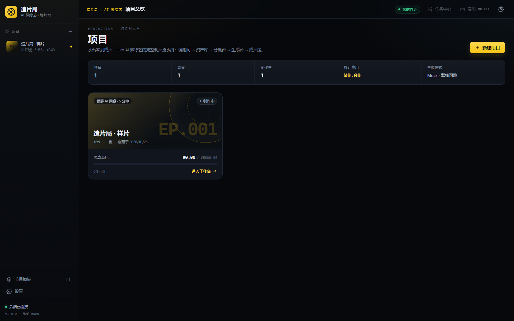
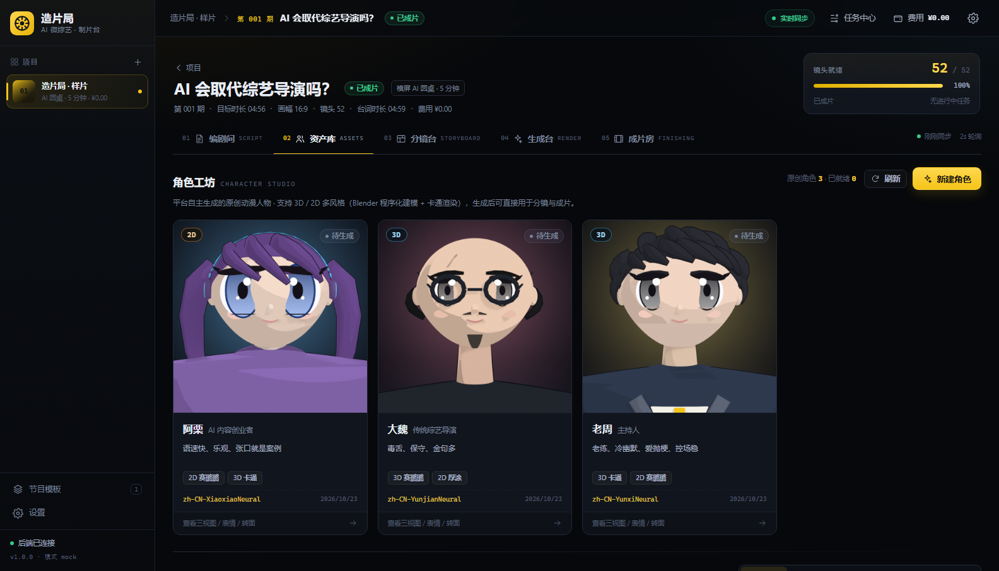
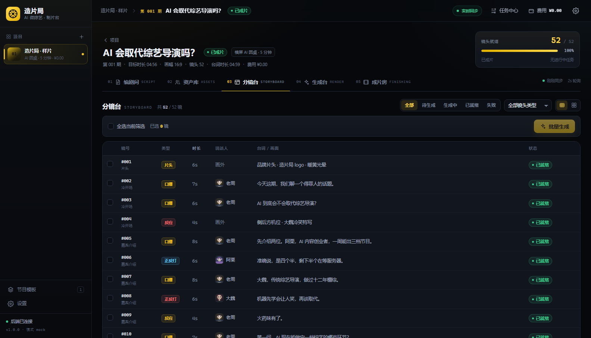

# 造片局 · AI 微综艺

> 横屏 5–10 分钟 AI 微综艺成片平台（demo）：**选模式 → 写台本 → 管资产 → 出分镜 → 批量生成 → 包装成片**。
> 品牌：造片局 ｜ 品类：AI 微综艺 ｜ 构建时间：2026-10-23 夜



## 这是什么

一个可运行的全栈 demo：以「AI 圆桌综艺」为第一个节目模式，把一期的台本、资产、52 个分镜、生成任务、时间线与成片串成一条流水线，最终输出 5 分钟横屏成片。**角色全部为平台自主生成的原创动漫人物**（Blender 程序化 3D/2D 风格 + 本机 MiniMax H3 真实生成镜头），中文配音/字幕/花字/BGM 齐全。

- 前端：ArcReel 式项目制工作台（编剧间 / 资产库 / 角色工坊 / 分镜台 / 生成台 / 成片房）
- 后端：FastAPI + SQLite，任务后台线程，角色工坊 API，ComfyUI(MiniMax H3) 适配器 + mock provider
- 角色：studio3d（Blender 程序化 3D/2D）+ studio2d（Pillow 2D）+ **imagegen（SDXL 动漫 AI 概念图，30 张）**
- 真实生成：integrations/comfyui（本机 MiniMax H3 int8 + 4step turbo，768²/5.17s 动漫镜头；生产默认）
- 快速测试：integrations/metaso（MetaSo 云端 MiniMax H3 API，5s 约 23–25s，测试用，可切换）
- 图像生成：imagegen（SDXL 动漫 Animagine XL 4.0，文生角色概念图/三视图/表情 + **IP-Adapter 一致性三视图/表情**）
- 导出：pipeline/capcut.py（pyJianYingDraft，剪映草稿 52 段）
- 流水线：ffmpeg 合成 + edge-tts 中文配音 + ASS 字幕/花字 + 片头片尾 + BGM，CLI 可独立运行

## 快速开始（Windows）

```powershell
# 0) 首次：安装依赖（前端 + ffmpeg 二进制 + Python 依赖）
cd tools; npm install; cd ..
pip install fastapi "uvicorn[standard]" sqlalchemy pydantic pillow edge-tts pytest httpx

# 1) 构建前端
.\scripts\build-frontend.ps1

# 2) 启动（http://127.0.0.1:8090/）
.\scripts\dev.ps1
```

打开 http://127.0.0.1:8090/ → 项目「造片局 · 样片」→ 进入工作台。

已有样例成片（无需启动）：[outputs/demo/final.mp4](outputs/demo/final.mp4)（299s / 1280×720 / 30.2MiB，全部原创动漫角色，52/52 镜头角色画面，H3 三人镜头全部生效；平台端 ep_001 成片 26MiB 同款）。

真实 H3 动漫镜头：[outputs/h3/laozhou_h3.mp4](outputs/h3/laozhou_h3.mp4)、[ali_h3.mp4](outputs/h3/ali_h3.mp4)、[dawei_h3.mp4](outputs/h3/dawei_h3.mp4)（768×768 / 5.17s / 含音轨）。

## 一键自检

```powershell
.\scripts\verify.ps1
```

包含：pytest、ffmpeg 版本、样例成片参数、API 健康检查。

## 功能一览

| 模块 | 能力 |
|---|---|
| 编剧间 | 按段落展示台本/台词/镜头数/时长，一键生成分镜 |
| 资产库 | 主持/嘉宾/场景卡，声音、人设、锁定状态 |
| 角色工坊 | 平台自主生成原创动漫角色：Blender 3D/2D 平涂 + **SDXL 动漫 AI 概念图**（立绘/三视图/4 表情/设定图）；新建角色→生成→入资产→H3 动画 |
| 分镜台 | 52 镜头，表格/宫格切换，状态过滤，批量生成，详情抽屉 |
| 生成台 | 任务队列（进度/费用/失败/重试）、多版本预览与选用 |
| 成片房 | 一键渲染、进度、成片播放、费用汇总、包装配置、**导出剪映草稿（52 段可编辑时间线）** |
| 设置 | 生成模式（mock/comfyui）、ComfyUI 地址、工作流模板、分辨率、TTS、计费单价 |






## 目录结构

```
backend/        FastAPI 应用（API、SQLite、任务、ComfyUI 适配器、角色 API）
frontend/       Vite + React + TS 工作台（构建产物 dist 由后端托管）
pipeline/       视频流水线（角色画面、TTS、ASS、ffmpeg 合成）
studio3d/       Blender 程序化原创动漫角色生成器（3D/2D 多风格）
integrations/   ComfyUI MiniMax H3 真实生成接入（workflow→API/run_h3）
contract/       API/CLI/角色契约、样例剧集（只读）
docs/           方案、架构、决策、验收指南、最终报告、截图
scripts/        启动/构建/渲染/截图/自检脚本
outputs/        样例成片、角色产物、H3 镜头（gitignore）
tools/          ffmpeg/ffprobe 二进制（npm 安装）
```

## 演示内容

《AI 会取代综艺导演吗？》第 001 期：3 位虚构 AI 动漫角色（老周/阿栗/大魏）围绕「AI 与综艺导演」的 5 分钟圆桌。角色由 studio3d 自主生成（3D 卡通/赛璐璐 + 2D 平涂），并由本机 MiniMax H3 真实生成 768² 动漫说话镜头；全部内容为虚构演示，无真人素材。

## 技术栈

FastAPI · SQLAlchemy · SQLite · Vite · React · TypeScript · FFmpeg 6.1 · edge-tts · Blender 5.0 · ComfyUI + MiniMax H3（本机真实生成）

## 已知限制（demo 边界）

- **H3 已真实生成**：本机 ComfyUI 用 int8 H3 + 4step turbo 产出 3 条角色镜头（768×768/5.17s/含音轨），成片优先使用 H3 视频/中段帧；不是每镜都跑 H3（52 镜只复用 3 条 H3 视频 + H3 静帧），单镜独立 H3 生成约 2–5 分钟/条（12GB 显存串行）。
- 角色 3D 立绘为 Blender 程序化生成（非手绘/非真实照片），赛璐璐化由 H3 增强；风格与精细度仍有提升空间。
- TTS 使用 edge-tts **在线合成**（需要网络）；失败时静音兜底。
- 转场为硬切，字幕烧录；剪映草稿/OTIO 导出为后续项。
- 长片质感（口型、多人同框、运镜）需接真实 H3/云模型后验证。
- 剪映 10.x 会加密草稿 JSON，明文草稿（pyJianYingDraft 社区格式）适用于 ≤5.9 或按 README 用 materials/+srt 重建；本机 10.3 实测不识别明文草稿。

## 文档

- 产品/技术方案：[docs/ai-variety-platform-plan.md](docs/ai-variety-platform-plan.md)
- 角色契约：[contract/CHARACTER.md](contract/CHARACTER.md)
- 角色生成器：[studio3d/README.md](studio3d/README.md)
- H3 接入：[integrations/comfyui/README.md](integrations/comfyui/README.md)
- 架构说明：[docs/ARCHITECTURE.md](docs/ARCHITECTURE.md)
- 决策记录：[docs/decisions.md](docs/decisions.md)
- API 契约：[contract/API.md](contract/API.md)
- 流水线 CLI：[contract/PIPELINE_CLI.md](contract/PIPELINE_CLI.md)
- 明早验收指南：[docs/DEMO_GUIDE.md](docs/DEMO_GUIDE.md)
- 最终报告：[docs/FINAL_REPORT.md](docs/FINAL_REPORT.md)
