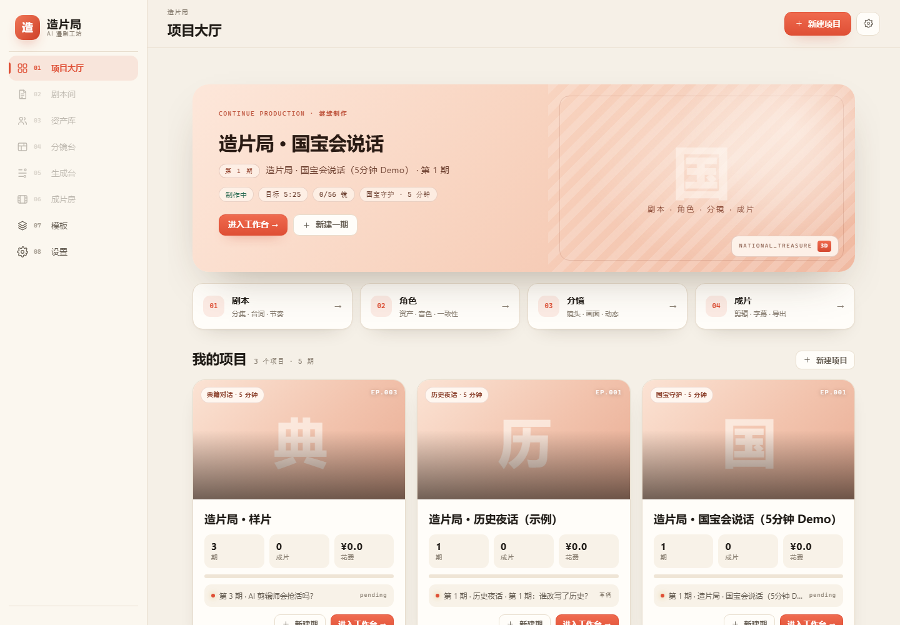

# 造片局 · AI 微综艺 / 漫剧工作台

[](LICENSE)
[](https://www.python.org/)
[](https://react.dev/)

> 横屏 AI 微综艺 / 漫剧生产工作台：**选模式 → 写台本 → 管资产 → 出分镜 → 批量生成 → 包装成片**。
> 品牌：造片局 ｜ 代码许可：MIT ｜ 2026-11 版本：33 模板 + 智能体编排 + Muse 视频/口型 + 漫剧工坊风 UI。

> **开源说明**：代码采用 MIT；AI 生成素材、第三方模型与服务的使用边界见 [NOTICE.md](NOTICE.md)。仓库**不包含**模型权重、API Key、成片与第三方二进制。



## 这是什么

一个可运行的全栈 demo：以「AI 圆桌综艺」为第一个节目模式，把一期的台本、资产、52 个分镜、生成任务、时间线与成片串成一条流水线，最终输出 5 分钟横屏成片。**角色全部为平台自主生成的原创动漫人物**（AI 3D 程序化 3D/2D 风格 + 本机 MiniMax H3 真实生成镜头），中文配音/字幕/花字/BGM 齐全。

- 前端：ArcReel 式项目制工作台（编剧间 / 资产库 / 角色工坊 / 分镜台 / 生成台 / 成片房）
- 后端：FastAPI + SQLite，任务后台线程，角色工坊 API，ComfyUI(MiniMax H3) 适配器 + mock provider
- 角色：ai_character（AI 3D 程序化 3D/2D）+ ai_character_2d（Pillow 2D）+ **imagegen（SDXL 动漫 AI 概念图，30 张）**
- 真实生成：integrations/comfyui（本机 MiniMax H3 int8 + 4step turbo，768²/5.17s 动漫镜头；生产默认）
- 全动态成片：pipeline/dynamic.py（H3 音驱动口型 ref2va + 首尾帧 fl2v + xfade 转场 + whoosh），静帧只用于片头尾/花字
- 一键发布：publish/ + Upload-Post（YouTube/TikTok/Instagram），成片房预检/发布/记录
- 模板库：16 个综艺模板（美式深夜秀/SNL/任务大师/叛徒/创智赢家/蒙面唱将/辣访谈/奇葩辩论/脱口秀/慢生活/推理/国宝/典籍 + 历史夜话/历史悬案），见 docs/VARIETY_REFERENCES.md；每个模板有镜头级验证片（outputs/template_demos），汇总见 outputs/template_demos/template_showcase.mp4
- 镜头级方法：参考 OpenMontage（12 pipelines/700+ skills）落地 shot grammar + 转场决策树 + ShotPlan 注入 H3，见 contract/SHOT_GRAMMAR.md、docs/OPENMONTAGE_NOTES.md
- 场景与风格：风格系统 v2 规划（docs/PLAN_V2_STYLE_LLM.md、contract/style_presets.json：12 preset + 16 模板独立风格）；LLM 内容生成契约（contract/LLM.md：本地 Ollama + OpenAI 兼容 API Key）；3D H3 demo outputs/h3_style_demos/tonight_show_3d.mp4；方法映射 docs/OPENMONTAGE_PRODUCTION.md、docs/STYLE_GUIDE.md
- 快速测试：integrations/metaso（MetaSo 云端 MiniMax H3 API，5s 约 23–25s，测试用，可切换）
- 图像生成：imagegen（SDXL 动漫 Animagine XL 4.0，文生角色概念图/三视图/表情 + **IP-Adapter 一致性三视图/表情**）
- 导出：pipeline/capcut.py（pyJianYingDraft，剪映草稿 52 段）
- 多语种出海：localize/（Ollama qwen2.5:7b 翻译 + NLLB 回退）+ pipeline/localize.py（多语 TTS/字幕/包装），成片房一键出 EN/ES/JA/KO/PT 版本
- 流水线：ffmpeg 合成 + edge-tts 中文配音 + ASS 字幕/花字 + 片头片尾 + BGM，CLI 可独立运行

## 快速开始（Windows）

```powershell
# 0) 首次：安装依赖（前端 + ffmpeg 二进制 + Python 依赖）
cd tools; npm install; cd ..
pip install fastapi "uvicorn[standard]" sqlalchemy pydantic pillow edge-tts pytest httpx

# 1) 构建前端
.\scripts\build-frontend.ps1

# 2) 启动（http://127.0.0.1:8090/）
.\scripts\dev.ps1
```

打开 http://127.0.0.1:8090/ → 项目「造片局 · 样片」→ 进入工作台。

已有样例成片（无需启动）：[outputs/demo/final.mp4](outputs/demo/final.mp4)（299s / 1280×720 / 30.2MiB，全部原创动漫角色，52/52 镜头角色画面，H3 三人镜头全部生效；平台端 ep_001 成片 26MiB 同款）。

真实 H3 动漫镜头：[outputs/h3/laozhou_h3.mp4](outputs/h3/laozhou_h3.mp4)、[ali_h3.mp4](outputs/h3/ali_h3.mp4)、[dawei_h3.mp4](outputs/h3/dawei_h3.mp4)（768×768 / 5.17s / 含音轨）。

## 一键自检

```powershell
.\scripts\verify.ps1
```

包含：pytest、ffmpeg 版本、样例成片参数、API 健康检查。

## 功能一览

| 模块 | 能力 |
|---|---|
| 编剧间 | **用户台本编辑器**（保存/脏标记/示例/一键填入），按段落展示台词/镜头数/时长，**从台本生成分镜** |
| 资产库 | 主持/嘉宾/场景卡，声音、人设、锁定状态 |
| 角色工坊 | 平台自主生成原创动漫角色：AI 3D 3D/2D 平涂 + **SDXL 动漫 AI 概念图**（立绘/三视图/4 表情/设定图）；新建角色→生成→入资产→H3 动画 |
| 分镜台 | 任意镜头数，表格/宫格切换，状态过滤，批量生成，**镜头增删/台词/时长编辑**，详情抽屉 |
| 生成台 | 任务队列（进度/费用/失败/重试）、多版本预览与选用 |
| 成片房 | 一键渲染（任意集/任意分镜数）、进度、成片播放、费用汇总、包装配置、**导出剪映草稿** |
| 设置 | 生成模式（mock/comfyui）、ComfyUI 地址、工作流模板、分辨率、TTS、计费单价 |


## 目录结构

```
backend/        FastAPI 应用（API、SQLite、任务、ComfyUI 适配器、角色 API）
frontend/       Vite + React + TS 工作台（构建产物 dist 由后端托管）
pipeline/       视频流水线（角色画面、TTS、ASS、ffmpeg 合成）
ai_character/       AI 3D 程序化原创动漫角色生成器（3D/2D 多风格）
integrations/   ComfyUI MiniMax H3 真实生成接入（workflow→API/run_h3）
contract/       API/CLI/角色契约、样例剧集（只读）
docs/           方案、架构、决策、验收指南、最终报告、截图
scripts/        启动/构建/渲染/截图/自检脚本
outputs/        样例成片、角色产物、H3 镜头（gitignore）
tools/          ffmpeg/ffprobe 二进制（npm 安装）
```

## 演示内容

《AI 会取代综艺导演吗？》第 001 期：3 位虚构 AI 动漫角色（老周/阿栗/大魏）围绕「AI 与综艺导演」的 5 分钟圆桌。角色由 ai_character 自主生成（3D 卡通/赛璐璐 + 2D 平涂），并由本机 MiniMax H3 真实生成 768² 动漫说话镜头；全部内容为虚构演示，无真人素材。

## 技术栈

FastAPI · SQLAlchemy · SQLite · Vite · React · TypeScript · FFmpeg 6.1 · edge-tts · AI 3D 5.0 · ComfyUI + MiniMax H3（本机真实生成）

## 已知限制（demo 边界）

- **H3 已真实生成**：本机 ComfyUI 用 int8 H3 + 4step turbo 产出 3 条角色镜头（768×768/5.17s/含音轨），成片优先使用 H3 视频/中段帧；不是每镜都跑 H3（52 镜只复用 3 条 H3 视频 + H3 静帧），单镜独立 H3 生成约 2–5 分钟/条（12GB 显存串行）。
- 角色 3D 立绘为 AI 3D 程序化生成（非手绘/非真实照片），赛璐璐化由 H3 增强；风格与精细度仍有提升空间。
- TTS 使用 edge-tts **在线合成**（需要网络）；失败时静音兜底。
- 转场为硬切，字幕烧录；剪映草稿/OTIO 导出为后续项。
- 长片质感（口型、多人同框、运镜）需接真实 H3/云模型后验证。
- 剪映 10.x 会加密草稿 JSON，明文草稿（pyJianYingDraft 社区格式）适用于 ≤5.9 或按 README 用 materials/+srt 重建；本机 10.3 实测不识别明文草稿。

## 文档

- 产品/技术方案：[docs/ai-variety-platform-plan.md](docs/ai-variety-platform-plan.md)
- 角色契约：[contract/CHARACTER.md](contract/CHARACTER.md)
- 角色生成器：[ai_character/README.md](ai_character/README.md)
- H3 接入：[integrations/comfyui/README.md](integrations/comfyui/README.md)
- 架构说明：[docs/ARCHITECTURE.md](docs/ARCHITECTURE.md)
- 决策记录：[docs/decisions.md](docs/decisions.md)
- API 契约：[contract/API.md](contract/API.md)
- 流水线 CLI：[contract/PIPELINE_CLI.md](contract/PIPELINE_CLI.md)
- 明早验收指南：[docs/DEMO_GUIDE.md](docs/DEMO_GUIDE.md)
- 最终报告：[docs/FINAL_REPORT.md](docs/FINAL_REPORT.md)

## Template v3（模板即节目形态，2026-10-26）

> 规划：`docs/PLAN_V3_TEMPLATE_REFACTOR.md`；交付报告：`docs/V3_REPORT.md`；独立验收：`docs/V3_ACCEPTANCE.md`。

- **16 个模板 v3**（`contract/templates_v3/*.json`）：舞台/角色站位/道具/动作库/镜头语言/H3 配置齐全，校验器 `pipeline/template_v3.py` 强制 16/16 通过。
- **每镜走 ComfyUI H3**：`pipeline/stage.py` 合成舞台首帧 → `pipeline/h3_comfy.py`（05_ref2va 音驱动口型，有台词 TTS / 无台词静音参考）→ `pipeline/render_v3.py` 剪辑/字幕/包装/混音 → `pipeline/qc_v3.py` QC 硬门。
- **证据链**：每镜 meta 含 `workflow / prompt_id / seed / ref_image / action`；`scripts/verify_h3_evidence.py` 可反查 ComfyUI `/history` 验证 prompt_id 真实存在。
- **成片**：16 模板各 30-45s 全 H3 demo（累计 84 个 H3 镜头、84 个全局唯一 prompt_id、blackdetect=0）→ `outputs/templates_v3/`；重点模板 5 分钟版 → `outputs/templates_v3/tonight_show_5min/final.mp4`。
- **复现**：`python -m pipeline.template_v3 --validate contract/templates_v3 --expect 16`；`python scripts/render_templates_v3.py --h3 comfy --duration 30`；`python -m pytest tests/test_v3_acceptance.py -q`。
- 说明：预演用 `--h3 previs`（静态首帧，QC 标 previs 不交付）；静态只允许片头/片尾卡片。本链路不使用 Blender。

## V4 语音与剪辑（Breeze TTS 2 + OpenFilm 式时间线，2026-10-26）

> 规划/报告：`docs/PLAN_V4_AUDIO_EDIT.md`、`docs/V4_REPORT.md`。

- **语音**：本地部署 **Breeze TTS 2**（官方 PyTorch 权重，Voice Design 三角色音色；`scripts/tts_server.py` 管理服务，端口 7861）；失败自动回退 edge-tts。
- **自然语速**：先配音、再按语音时长确定镜头长度（H3 17k+5 帧网格 + lead/tail），**彻底移除 atempo 加速**；长句自动切分多镜，不再截断。
- **剪辑**：`timeline.json`（V1 视频 / A1 语音 / A2 音乐 / A3 音效 / S1 字幕 五轨）+ `timeline.html` 预览；`pipeline/edit_v4.py` 可独立从时间线重渲（非破坏剪辑）；BGM sidechain ducking、两遍响度目标 -16 LUFS。
- **QC 增量**：`audio_pace` 硬门（atempo=1.0 / 无截断 / 语音装进镜头）。
- **复现**：`python scripts/tts_server.py start` → `python -m pipeline.cli render_v3 --template tonight_show --duration 40 --h3 comfy --force`；A/B 对照加 `--legacy-audio`。
- 说明：Breeze TTS 2 权重为 research / non-commercial 许可（demo 用途；商用需 BreezeBlue 授权）。

## V5 风格世界 + 口型同步 + 全量自定义（2026-10-26）

> 规划/报告：docs/PLAN_V5_STYLE_AUDIO.md、docs/V5_REPORT.md；验收：docs/V5_ACCEPTANCE.md。

- **16 种截然不同的视觉风格**：水墨史书 / 版刻典籍 / 羊皮纸档案 / 博物馆金黑 / 霓虹卡通 / 全息舞台 / VHS / 暖光胶片 / 黑色电影 / 文艺复兴油画 / 巴洛克烛光 / 科技蓝图 / 糖果拼贴 / 黏土定格 / 粉笔剧场 / 绢本辩论；历史类含古地图、战场、军议、宫殿等场景。
- **口型同步**：对白镜用 2D 角色 + TTS 音素时间轴驱动 viseme（零漂移）；pipeline/lipsync.py 交付 MuseTalk 1.5（48ms/帧、6.85GB、MIT）作为 H3 B-roll 可选后处理。
- **可自定义**：contract/v5/ 六类 JSON（styles/scenes/characters/props/templates/packs）+ custom/ 覆盖 + schema 校验 + CLI（python -m pipeline.v5_cli validate/list/export/preview）+ API（/api/v5/...），教程 docs/V5_CUSTOMIZATION.md。
- **渲染**：python -m pipeline.cli render_v5 --template history_talk --duration 40；批量 python scripts/render_templates_v5.py --duration 40 --refresh；产物 outputs/templates_v5/{id}/。
- 规模：**16 风格 / 61 场景 / 24 角色 / 44 道具 / 2 风格包**，契约 validate 0 error/0 warning。

## V5.2 AI 美术升级 + V5 世界前端（2026-10-26）

> 规划/报告：docs/PLAN_V5_2_ART_FRONTEND.md、docs/V5_2_REPORT.md；场景美术：docs/V5_2_SCENE_ART.md；前端：docs/V5_2_FRONTEND.md；验收：docs/V5_2_ACCEPTANCE.md。

- **美术全面换成 AI 动漫资产**：SDXL Animagine XL 4.0 生成 24 角色立绘（portrait + 全身白底 front + 泛洪抠图 cutout；front 用 IP-Adapter 以 portrait 为参考保证同画风）与 61 场景 plate（1280×720，无人物动漫背景；历史 13 场景含古地图/战场/军帐/宫殿/博物馆/考古/关隘等）；最早的 laozhou/ali/dawei 沿用 V3 资产。
- **16 风格保留**：style_v5.apply_finish 对 AI plate/立绘做 16 种强风格化（水墨/版刻/羊皮纸/博物馆/霓虹/全息/VHS/胶片/黑色电影/油画/巴洛克/蓝图/糖果拼贴/黏土/粉笔/绢本），16 部成片风格可辨。
- **V5 世界前端**：http://127.0.0.1:8090/#/v5（React 工作台新增页）：成片画廊（播放/QC/时间线）、风格墙、场景库、角色库（AI 立绘 + 固定声音试听/修改/重建声音锁）、渲染面板（提交后台渲染 + 进度/取消）；API /api/v5/outputs、/media/v5/*、/api/v5/voice/{id}、/api/v5/render*。
- 渲染：python scripts/render_templates_v5.py --duration 40 --refresh；单部 python -m pipeline.cli render_v5 --template history_talk --duration 40。
- 资产：ssets/v5/characters/<id>/（24）、ssets/v5/scenes/<id>.png+json（61）；提示词 contract/v5/art/prompts.json；复现 python scripts/gen_v5_scene_art.py、python scripts/gen_v5_character_art.py（front: scripts/regen_v5_character_fronts.py）。

> V5.3：设置里 V3/V4 的「工作流模板(h3_roundtable.json)+声音映射」旧面板已从 UI 删除（V5 不用）；前端「V5 世界 → 模板库」展示每个模板自己的工作流（分镜/固定声音/场景/角色/动画/字幕/混音）、场景与角色组合，并支持编辑模板 JSON / 一键用该模板渲染。16 模板 16/16 风格、场景集合、演员组合互不相同。

## V5.4 电影级剪辑 / 镜头 / 分镜 / 转场（2026-10-26）

> 计划/报告：docs/PLAN_V5_4_EDITORIAL.md、docs/V5_4_REPORT.md、docs/V5_4_EDITING.md；验收：docs/V5_4_ACCEPTANCE.md。

- **每模板不同剪辑档案**：contract/v5/editorial/<id>.json（pacing/开场收尾/分镜序列/运镜调色板/转场调色板/硬切比例/J-L cut/insert 比例），16 份互不相同（camera 覆盖 17 种、transition 覆盖 14 种）。
- **17 种电影级运镜**（motion2d）：push/pull/pan/truck/tilt/crane/dolly/dolly_zoom/rack_focus/orbit/whip_pan/handheld…；按景别与档案自动选镜，角色镜保证头安全（虚拟取景窗）。
- **每剪辑点独立转场**（pipeline/editing.py）：37 种 ffmpeg xfade + 甩镜过渡、J/L cut 音频重叠、成片时长按 EDL 精确；参考 libopenshot/OpenTimelineIO/open-montage/parallax-maker/ffmpeg xfade 的模型。
- **分镜产物**：每部成片输出 storyboard.json/html/png；	imeline.json 增加 editing 轨与每镜 shot_size/camera/transition；前端「V5 世界 → 模板库 → 分镜/剪辑」可看分镜表/时间线/剪辑档案（#/v5/templates/<id>/storyboard）。
- 重渲：python scripts/render_templates_v5.py --duration 40 --refresh；单部 python -m pipeline.cli render_v5 --template history_talk --duration 40。

## V6 智能体工作台（Agent Orchestration，2026-10-26）
- 前端：「V5 世界 → 智能体」面板（工作流编辑/运行日志/修改/美术资产/运行记录，`#/v5/agent`）；

参考 [ArcReel](https://github.com/ArcReel/ArcReel)（AI Agent 驱动的小说→角色/场景/剧本/分镜/视频工作台）：
- **8 个角色智能体**：制片 / 编剧 / 声音导演 / 美术 / 剪辑 / 视频导演 / 质检 / 发布；
- **每模板可编辑工作流**：`contract/v6/workflows/<template>.json`（stages/agents/tools/depends/params）；
- **9 个工具**：build_story / synthesize_voices / plan_editing / render_shots / render_h3 /
  assemble_episode / build_storyboard / evaluate_qc / write_report；
- **智能体式修改**：`python -m pipeline.agents edit --op set_voice|patch_editorial|patch_template|patch_workflow`
  → 自动返回受影响阶段 + 增量重跑命令；
- **验收门 + run 证据**：每次执行写 `outputs/agent_runs/<run_id>/{run.json,events.jsonl,summary.md}`，
  QC 硬门不过即失败；
- 文档：`AGENTS.md`、`docs/V6_AGENT_ORCHESTRATION.md`；CLI：`python -m pipeline.agents list|inspect|run|edit|status`。


## V7–V49 概览（2026-11-05 更新）

> 完整功能梳理与计划核对：[docs/V49_FEATURE_MAP_AND_PLAN_CHECK.md](docs/V49_FEATURE_MAP_AND_PLAN_CHECK.md)；
> V49 主线与验收：[docs/PLAN_V49_SHORTS_SEASON.md](docs/PLAN_V49_SHORTS_SEASON.md)。
> 上面 V3–V6 章节保留为历史记录；当前平台规模以本节为准。

- **平台**：15 个页面（项目大厅 / 编剧间 / 资产库 / 分镜台 / 生成台 / 成片房 / 3D 镜头台 / 生成队列 / 剪辑台 / 一键成片 / 角色与声音 / 模板库 / 风格墙 / 场景库 / 成片库）+ **142 个 API 端点**（17 功能域）；前端 hash 路由，后端托管 dist。
- **内容**：**33 个模板**（16 内建综艺 + 17 custom 短片/示例）、17 种风格、74 个场景、50 个角色、44 个道具、16 份剪辑档案；每模板一份可编辑工作流。
- **智能体（V49 上线）**：8 角色 + 13 工具 + 33 份工作流；两条生产栈（base 走 `render_v5`，`custom_tpl_*` 走 `templates3d_hq`）；页面 `#/agent`（模板/工作流/运行/季面板），CLI 与页面等价（`python -m pipeline.agents ...`）。
- **季（Season）**：`contract/v5/series/<sid>.json` + `/api/v6/agent/season/{sid}/run`（`dry_run`/`only_missing`）+ 合集导出 `POST /api/v5/series/{sid}/export`（片头卡 + 串片 + manifest）。
- **已交付产物**：30 部 3D 成片（`outputs/templates_3d`）、9 部 2D 短片（`templates_2d`）、18 部 V3 样片、2 部 5 分钟长片（`tonight_show_5min` 299s / `relic_talk_3d` 325s）、系列合集 49.2s。
- **测试**：`pytest tests -q`（21 文件 343 用例）+ `pytest pipeline/tests -q`（17 文件 185 用例）。

**当前主线（用户 2026-11-05 决策）**：短片线——一个世界 = 一季，一季 = N 集（13–25s/集），每集由智能体工作流生产，一季导出合集；长片能力保留（`relic_talk`/`relic_talk_3d`）但不再扩产。

## V50 Muse（MuseTalk 1.5）口型生成（2026-11-05）

> 文档：[docs/V50_MUSE_GENERATION.md](docs/V50_MUSE_GENERATION.md)

- **真实可用**：MuseTalk 1.5 权重与 venv 已在本机（`local_models/lipsync*`，torch 2.9.1+cu128 / RTX 3080 Ti）；实测单镜 **21s**（3.29s / 79 帧 / 1024×576 / 56ms 每帧 / 显存 6.8GB）。
- **三个入口**：`POST /api/v6/muse/sync`、`python -m pipeline.agents run --stages muse`、页面 `#/agent` 的「Muse 口型修正」卡片（可用性 / 最近片段 / 日志）。
- **产物**：`outputs/muse/<template>/<shot>_muse.mp4`（h264 + aac）→ `/media/muse/...`；`params.apply=true` 可回写 `shots/` 并重新合成成片（原件备份 `shots/_orig/`）。
- **并发安全**：跨进程独占锁 `tmp/v5_lipsync/.muse.lock`（死锁持有者按 PID 立即回收），CLI / API / agent 同时只跑 1 个任务。

## V50.1 Muse 视频模型接入（MuseV / MusePose / 云端）

> 手册：[docs/MUSE_VIDEO_INTEGRATION.md](docs/MUSE_VIDEO_INTEGRATION.md)

- **适配层**：`pipeline/muse_video.py`，四类 provider 同一签名：`musev_local` / `musepose_local` / `muse_cloud` / `stub`；`python -m pipeline.muse_video --check` 自检。
- **入口**：`POST /api/v6/muse/video`（后台任务 + 轮询）、智能体工具 `muse_video`、工作流阶段 `musev`（默认关）、页面「Muse 视频」卡片。
- **云端分支已实测**：POST → 轮询 → 下载 → ffprobe（640×360 / 2s / 3.04s 完成）。本地分支需按手册安装 MuseV/MusePose。
- **同步分**：`measure_sync()` 返回「嘴动 ↔ 语音包络」相关（实测 corr_best=0.21 / lag=-1 帧）；SyncNet 权重损坏（886MB 下载中断），暂不出 LSE 分。
- **季批量口型**：`POST /api/v6/agent/season/{sid}/run {with_muse:true}` → 全部集数只跑 `muse`。
- **1080P 合集**：`POST /api/v5/series/{sid}/export?force=true&hd=true` → 1920×1080 / 38.1MB。

## V51 Muse 进片 + 季批量口型 + 1080P（2026-11-05）

> 记录：[docs/V51_MUSE_INTO_FILM.md](docs/V51_MUSE_INTO_FILM.md)

- **阶段参数可覆盖**：`--stage-params '{"muse":{"apply":true}}'`（API 同名字段），不改合同、只对本次 run 生效。
- **Muse 进片**：口型结果回写 `shots/`（原件 `_orig/`）+ 重新合成；实测 cyber `final.mp4` sha 由 `7cfbd90e` → `5d58619d`，QC 全绿。
- **季批量口型**：`season/run {with_muse:true, muse_apply:true, dry_run:false}` → 3 集一次跑完，三集成片 sha 全变。
- **修 bug**：短片在 `templates_2d`/`templates_3d` 各有一份成片，导出改按 **mtime 取最新**（否则合集一直用旧片）。
- **单集 1080P / 竖版**：`python -m pipeline.deliver --template X --hd|--vertical` → `final_1080p.mp4` / `final_9x16.mp4`。

## V52 全量代码审查与修复（2026-11-05）

> 记录：[docs/V52_CODE_REVIEW_FIXES.md](docs/V52_CODE_REVIEW_FIXES.md)｜明细：docs/audit/REVIEW_{BACKEND,PIPELINE,AGENTS,FRONTEND}.md

- 4 个只读审查员分头审全仓，汇总 P0–P3 后逐条修：**2 个 P0、6 个 P1、16 个 P2/P3** 已修；
- 典型：`render_v5` 分支缩进致成片不渲、音色 PUT 毁角色合同、模板替换污染同进程、SystemExit 卡死 job、发布静默发中文母版、合集缓存不随单集更新；
- 回归：`pytest tests -q` 491 passed；58 条 GET 探针 0 个 5xx；季证据三链接全 200。

## V53 把审查 backlog 全部修完（2026-11-05）

- 关键帧缓存加入 prompt 指纹 + `hq --force`；`render_v5` 台词镜不再假封顶、trim 先缩 b-roll；
- `qc_v5` 的 `lip_sync` 硬门终于有数据（viseme 时间轴）；`video_raw`/`narration` 拷贝失败改为硬失败；
- 工作流 JSON 损坏不再静默回退（`degraded` → 拒绝执行）；Muse 回写/重合成失败自动回滚并刷新 QC；
- 季合同改为 `same_cast:false, same_world:true` + `season_warnings` + `scripts/check_seasons.py`；
- `gen-shot` 加超时、job spec 自动裁剪、输出目录统一 `OUTPUTS_DIR`、预检只认 ready 本地化；
- 新增 `scripts/fetch_syncnet.py`（权重校验/重下）；回归：491 passed，58 条 GET 0 个 5xx。

## V53.1 第二轮审查的回归修复（2026-11-05）

- 修掉自己引入的 3 个 P0：`/muse/sync`、`/muse/video` 缺 `global` 导致 100% 500，`/muse/video` 输出路径未校验；
- 输出根统一 `pipeline.config.OUTPUTS_ROOT`（env 优先），不再“写仓库读 config”；
- `hq --force` 真正生效、关键帧缓存不再被旧图毒化；`render_v5` trim 后重建音轨（消除音画错位）；
- `lip_sync` 改成真检查（viseme 张嘴覆盖率），工作流保存校验依赖/工具，悬空依赖判 failed；
- 新增 `tests/test_v53_agents.py`（10 条）；回归：**501 passed**，58 条 GET 0 个 5xx。
