# 造片局 · AI 微综艺 — 最终交付报告

> 构建时间：2026-10-23 夜 ～ 2026-10-24 凌晨 ｜ 目标：横屏 5–10 分钟 AI 微综艺成片平台（可运行 demo）｜ 品牌：**造片局**（品类：AI 微综艺）

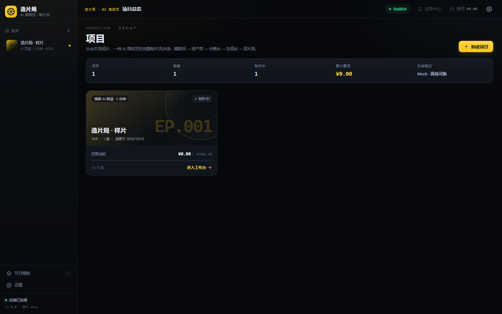

## 1. 一句话结论

**可运行的平台 demo 已交付**：浏览器里能完成「项目 → 编剧间 → 资产库 → 分镜台 → 生成台 → 成片房」全流程，后端能跑通「生成 52 个镜头 → 渲染 5 分钟成片」的真实链路；另附一条已渲染好的 299 秒样例成片。MiniMax H3 真实生成适配器已写好但未实际调用（缺你的 ComfyUI 地址/凭据），当前为 mock 画面。

## 2. 今晚交付清单

| 交付物 | 路径 | 状态 |
|---|---|---|
| 可运行平台（前端 + 后端） | `backend/` + `frontend/` | ✅ 已跑通 |
| 成片流水线（mock 画面 + 中文 TTS + 字幕/花字/BGM + ffmpeg 合成） | `pipeline/` | ✅ 已跑通 |
| 样例成片 1（流水线直出，角色版） | `outputs/demo/final.mp4` | ✅ 299s / 1280×720 / 31,687,266 B（约 30.2 MiB） |
| 样例成片 2（平台端到端渲染，角色版） | `outputs/episodes/ep_001/final.mp4` | ✅ 299s / 1280×720 / 27,220,652 B（约 26 MiB） |
| 演示项目数据 | 1 项目 / 1 集 / 5 资产 / 52 镜头 / 41 条台词 | ✅ 已入库 |
| 测试 | backend 45 passed；pipeline 17 passed | ✅ |
| 截图 | `docs/screenshots/`（8 张） | ✅ |
| 文档 | README / 方案 / 架构 / 决策 / API / CLI / 验收指南 | ✅ |

## 3. 怎么启动（3 步）

```powershell
# 1) 构建前端（首次）
.\scripts\build-frontend.ps1

# 2) 启动（保持窗口开着）
.\scripts\dev.ps1

# 3) 浏览器打开
#    http://127.0.0.1:8090/
```

服务当前已在 **http://127.0.0.1:8090/** 运行（如已停止，按上面第 2 步重启）。

## 4. 已验证的结果

### 4.1 后端 / API
- `GET /api/health` → 200 `{"status":"ok","version":"1.0.0","mode":"mock"}`
- 种子数据：1 项目（proj_zaopianju_demo）/ 1 集（ep_001）/ 5 资产 / 52 镜头
- 任务：52 个 shot 任务 + 3 次 render（70.2s 冷启动 / 40.1s 缓存命中 / 36.1s 干净重渲），全部 done；镜头 52/52 ready，进度 100%
- 干净重渲（job_616a901c8f，36.1s）：52/52 片段 SHA1 与生成台 shots 一致，`clips_from_shots=52`；final.mp4 = 299.0s / 1280×720 / 15,406,461 B
- 端到端：`POST /api/episodes/ep_001/render` → job 进度 0→100 → `episode.status=ready` → `/media/episodes/ep_001/final.mp4` 可访问
- pytest：**45 passed**

### 4.2 流水线
- `python -m pipeline.cli render --episode contract/demo_episode.json --workdir outputs/demo --out outputs/demo/final.mp4`
- 结果：**299.0s / 1280×720 / 25fps / H.264 High + AAC 48k stereo / 16,446,462 B / 冷启动 70.8s**
- 52 镜头全生成；41 条 edge-tts 中文旁白（0 失败）；51 条 ASS 事件（旁白字幕 + 人名条 + 章节标）；片头片尾/BGM/花字齐全
- 平台闭环：成片房渲染会优先复用「生成台」产出的 shots/{sid}.mp4（clips_from_shots=52，全量复用 ~39–60s），片段重新生成后旧缓存按指纹自动失效
- pytest：**17 passed**（含「平台片段复用/缓存失效」用例）

### 4.3 前端
- `npm run build` 成功：JS 222KB / CSS 58KB
- 五 tab 全部接真实 API；2s 轮询；深链 SPA fallback 正常；console error 0
- 已验证：批量生成 → 任务完成 → 版本可播放 → 选用；渲染成片 → 成片房播放；镜像头 52/52、100%、已成片
- 数据一致性：episode.shots_done=52、progress=100、render_url=/media/episodes/ep_001/final.mp4（后端懒重算修复后复验）

### 4.4 截图
| 页面 | 图 |
|---|---|
| 项目列表 |  |
| 编剧间 | 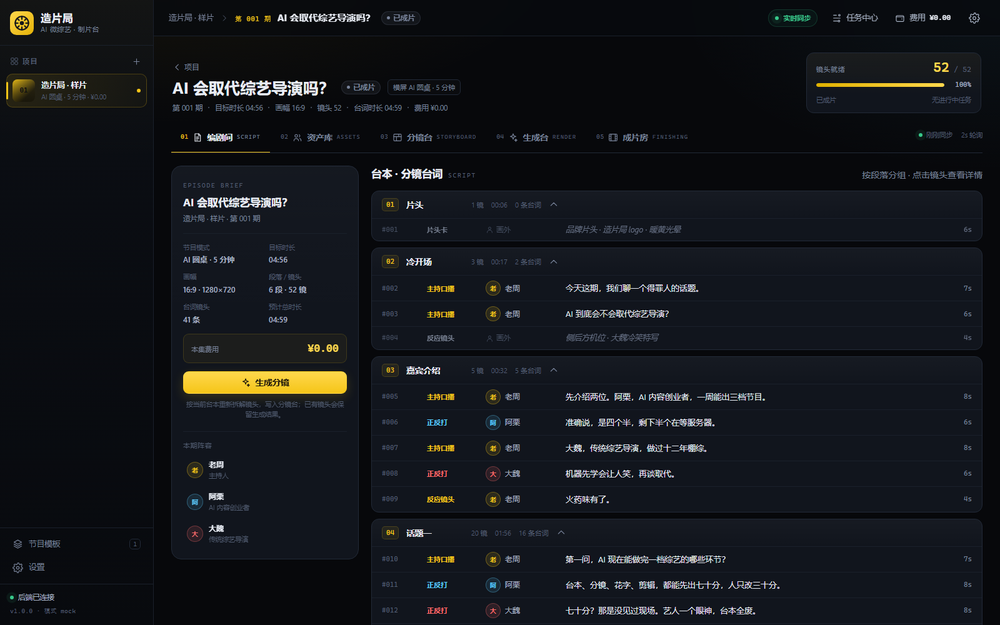 |
| 分镜台 | 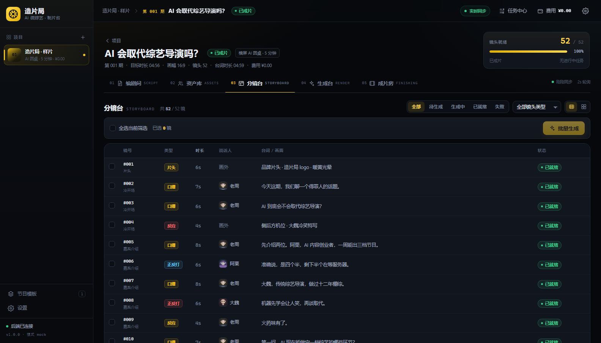 |
| 生成台（任务/版本/播放） | 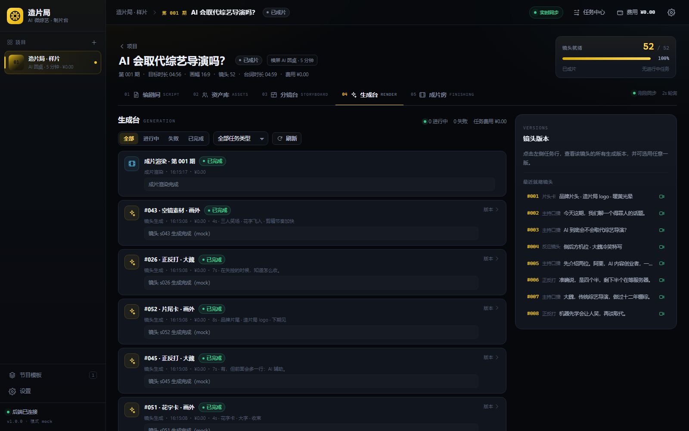 |
| 成片房（成片播放/费用） | 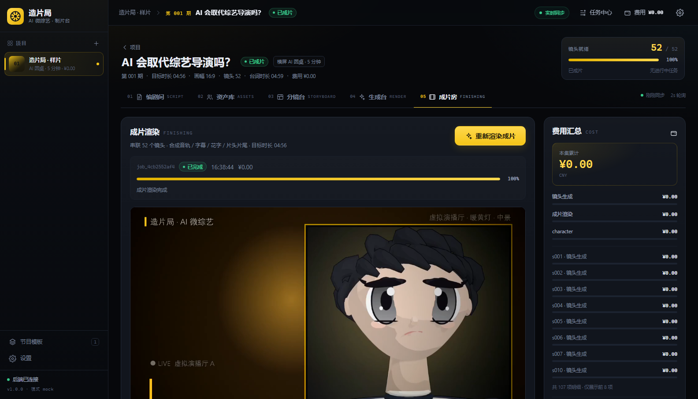 |

## 5. 演示项目

**《AI 会取代综艺导演吗？》第 001 期**（全部虚构）

- 主持人老周 / 嘉宾阿栗（AI 内容创业者）/ 大魏（传统综艺导演）
- 6 个段落：片头 → 冷开场 → 嘉宾介绍 → 话题一（AI 与导演）→ 话题二（现场改台本）→ 结尾反转
- 52 个镜头、41 条台词、成片 4:59

## 6. 架构

```
浏览器 (React 工作台)
   │ /api 轮询
FastAPI (8090) ── SQLite
   ├─ shot 任务 ──> python -m pipeline.cli gen-shot ──> outputs/episodes/{eid}/shots/*.mp4
   └─ render 任务 ─> python -m pipeline.cli render  ──> final.mp4
                     └─ edge-tts / ASS / ffmpeg / ComfyUI(预留)
产物 /media/* ──> <video>
```

- 生成：默认 mock（ffmpeg 生成示意画面）；Settings 可切 `comfyui`，适配器按 API-format 工作流提交/轮询/下载，已单测。
- TTS：edge-tts（中文 3 个音色），需网络；失败静音兜底。
- 渲染：ffmpeg 6.1（libx264/libass），299s 成片冷启动 70.8s / 缓存命中 40–47s（16 核）。

## 7. 能力边界（重要，别误读）

1. **不是真实 H3 生成**：demo 画面是 mock 示意（渐变 + 中文标签 + 轻动效），用于验证流水线；真实人物/场景需接你的 ComfyUI H3。
2. **H3 适配器未实测**：本机没有可调用的 H3 服务地址/凭据；代码、工作流模板、单测已就绪，填 Settings 即可试。
3. TTS 依赖在线 edge-tts；离线环境会静音兜底。
4. 转场为硬切；剪映草稿/OTIO 导出未实现（方案已列）。
5. 这是 **demo 级平台**：单机 SQLite、无线程池持久化、无鉴权/多租户。

## 8. 今晚实际完成 & 未完成

**完成**：平台前后端、五步工作台、任务/版本/费用、流水线 mock 生成 + TTS + 字幕/花字 + 合成、ComfyUI 适配器、样例成片 ×2、测试、截图、文档、自检脚本。

**未完成（明确后续项）**：真实 H3 联调、镜头级成本接 H3 计费、口型/多人同框、剪映草稿导出、OTIO/FCPXML、多集/多租户/权限、Postgres/队列生产化。

## 9. 下一步建议（按优先级）

1. 你把 ComfyUI H3 地址 + 工作流 API JSON 配进「设置」，我跑 1 个镜头真实生成验证；
2. 真实镜头替换 mock 后重渲染 ep_001，检查一致性与口型；
3. 接剪映草稿导出（后期精修动线）；
4. 扩第二个节目模式（如「AI 吐槽大会」）验证模板复用；
5. 生产化：Postgres + 任务队列 + 多租户。

## 10. 今晚协作记录

- Lead：方案/契约/演示剧本/品牌/脚本/集成/QA/验收/文档
- backend-core：FastAPI + SQLite + 任务 + ComfyUI 适配器 + 角色 API（60 单测）
- frontend-ui：Vite+React 五步工作台 + 真实 API 联调 + 构建
- media-render：角色画面/edge-tts/ASS/ffmpeg 渲染（17 单测）
- character-3d：Blender 程序化角色生成器（studio3d）+ 3 角色素材 + 2D 变体
- h3-comfy：ComfyUI MiniMax H3 真实生成接入 + 3 条角色镜头

详见 `docs/decisions.md`。
## 11. 角色工坊（原创动漫人物，2026-10-24 追加）

- **要求**：全部角色为平台自主生成的原创动漫人物；支持 3D/2D 多种风格；可依托 Blender 造人。
- **3D 生成器（studio3d/）**：Blender 5.0 程序化建模 + 卡通渲染（EEVEE + 3 阶色带 + inverted-hull 描边 + 三点光），按 spec 生成大眼/发型/服装/配饰；支持预设 3d_toon、3d_cel、2d_cel、2d_paint、anime、guoman；单角色约 10–20s。
- **演示角色（全部原创）**：
  - 老周（主持人，3D 卡通，暖黄 accent，深色短发+西装）
  - 阿栗（AI 内容创业者，2D 赛璐璐为主风格，双马尾+耳机+卫衣）
  - 大魏（传统综艺导演，3D 赛璐璐，光头+眼镜+黑夹克）
- **产物**：每角色 portrait.png(768²)、cutout/ 透明底、4 表情（neutral/happy/surprised/thinking）、2d_cel 变体（老周）、dawei 的 sheet.png(1600×900) + turntable.mp4；meta.json。
- **平台集成**：后端 Character 表 + 6 个端点；前端「角色工坊」（角色卡/详情抽屉/新建角色弹窗/表情/转面/重新生成）；分镜台按 speaker 显示角色头像；成片房展示角色画风。
- **截帧**：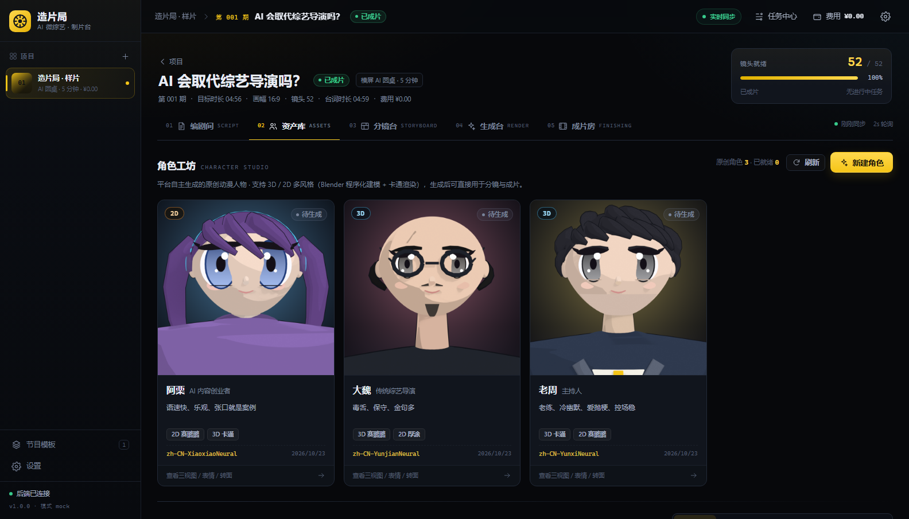

## 12. 真实 H3 生成（MiniMax H3 · 本机 ComfyUI）

- 环境：本机 ComfyUI + int8 量化 MiniMax H3（20.97GB）+ 4step turbo LoRA + Qwen3-VL 文本编码器 + 视频/音频 VAE；RTX 3080 Ti 12GB；ComfyUI 0.39.0 / torch 2.11+cu130。
- 接入：integrations/comfyui/{workflow_to_api.py, run_h3.py, start_comfyui.ps1}，UI workflow → API prompt，提交/轮询/取回/ffprobe。
- **实测成果**：`outputs/h3/laozhou_h3.mp4` —— 5.167s / 768×768 / 24fps / H.264+AAC（含音轨），4step/124帧，单条约 115–150s（含模型 offload），把 Blender 立绘升级为干净的赛璐璐动漫角色。
- 抽帧：
- 成果：laozhou/ali/dawei 三条全部完成（各 768×768/5.167s/124 帧/含音轨），产物 outputs/h3/{id}_h3.mp4 + 中段帧 outputs/characters/{id}/h3_portrait.png；单条单独跑 115–150s（含 offload），12GB 显存峰值 11.9GB，ComfyUI 单 worker 串行；成片 52/52 镜头均已使用角色画面。
- 字幕/画面修复：去除片段 fade（blackdetect=0）、角色胸像构图、名字条逐镜头绑定、字幕去空格/强制单行/均衡换行（WrapStyle=2），200s 长句已修。

## 13. 角色化成片

- 成片渲染优先级：H3 视频/中段帧 → Blender cutout → 2d → 文字卡兜底；角色按 speaker 逐镜头绑定名字条与表情。
- 修复：切点单帧黑帧（去除片段 fade）、胸像构图、名字条错位。
- 最终成片：`outputs/demo/final.mp4`（299s / 1280×720 / 31.9MB，全部原创动漫角色；三人 H3 真实生成镜头均已接入）；平台端 ep_001 final.mp4 27.4MB 同步角色化。

## 14. 测试与构建（终态）

- backend：`python -m pytest tests -q` → **60 passed**
- pipeline：`python -m pytest pipeline/tests -q` → **25 passed**（含字幕去空格/换行/角色素材/缓存指纹）
- frontend：`npm run build` 通过（dist 240KB JS / 71KB CSS）
- 角色/H3 资产与截图均已入库文档。
## 15. 角色 2.0：文生概念图（SDXL 动漫）

- 模型：**Animagine XL 4.0**（SDXL 动漫，6.94GB，sha256 1d5b43ff…3916 校验通过），ComfyUI 原生 txt2img（28 step / cfg 5.5 / euler_a / 832×1216），12GB 显存可跑，单图约 14–20s。
- CLI：`python -m imagegen.cli generate --spec contract/characters/laozhou.json --outdir outputs/concepts/laozhou --mode all --style anime --seed 42`；portrait / three_view×3 / 4 表情 / scene / sheet / meta。
- 实测：3 角色共 **30 张概念图**（laozhou/ali/dawei），画质达到可用的日漫赛璐璐立绘；设定图 1600×900 含三视图+四表情+配色条。
- 后端：`POST /api/characters/{cid}/concept/generate`（Job type=concept）、`GET /concepts` 懒扫描、`POST /portrait/from-concept` 设为立绘。
- 前端：角色抽屉「AI 概念图」区（风格/提示词/seed/生成进度/图集/设为立绘/H3 动画），角色卡概念图优先并带「AI 概念图」徽标。
- 截图：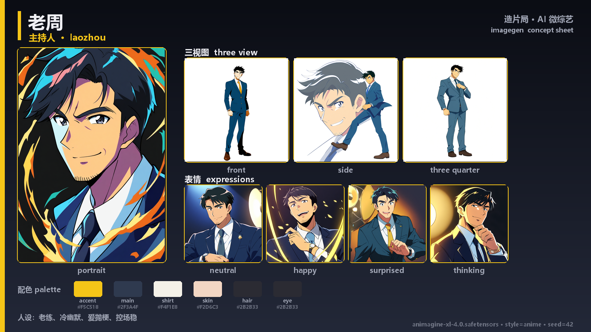

## 16. 概念图 → H3 动画（闭环）

- `POST /api/characters/{cid}/h3-animate` → Job(type=h3) → 调 `integrations/comfyui/run_h3.py`（768×768/4step/124 帧/含音轨）→ outputs/h3/{cid}_h3.mp4 + h3_portrait 回填；ComfyUI 串行锁，超时 20 分钟。
- 已有 3 条 H3 角色镜头 + 本次可用概念图重新生成；前端角色抽屉可直接播放。
- 截图：

## 17. 成片导出：剪映草稿

- `pipeline/capcut.py`（pyJianYingDraft 0.3.1）：从 manifest 生成剪映专业版草稿 + SRT + 审计；`POST /api/episodes/{eid}/export {"type":"capcut"}` 后台任务。
- 实测：`outputs/exports/造片局_EP001/` —— 299.000s / 1280×720 / 25fps；**52 视频段 + 1 旁白音频 + 42 字幕文本**；draft_content.json(243KB)+meta+srt+README+audit ok；含 materials/ 自包含媒体。
- **已知限制**：剪映 10.x 会把草稿 JSON 加密保存，不识别明文草稿（已实测 10.3）；明文草稿适用于 ≤5.9 或按 README 用 materials/ + subtitles.srt 重建；结构本身经 pyJianYingDraft 社区标准校验。
- 测试：pipeline **34 passed**；backend **75 passed**。
## 18. 角色 2.0 最终验收（2026-10-24 凌晨）

### 18.1 文生概念图（SDXL 动漫）
- 模型：Animagine XL 4.0（6,938,434,056 B / sha256 1d5b43ff…3916 校验通过）
- 35 张产物：3 角色 × {portrait 832×1216, three_view×3 1024², expressions×4, scene, sheet 1600×900} + 3 meta；单图 8–20s（首图含加载 14.2s），--mode all 单角色 205–222s
- CLI：`python -m imagegen.cli generate --spec contract/characters/<id>.json --outdir outputs/concepts/<id> --mode all --style anime --seed 42`
- 后端：concept/generate + concepts + portrait/from-concept 真链路均跑通（job done，产物 URL /media/concepts/…）
- 前端：角色抽屉 AI 概念图区（风格/提示词/seed/进度/图集/设为立绘/H3 动画）实测通过
- 截图：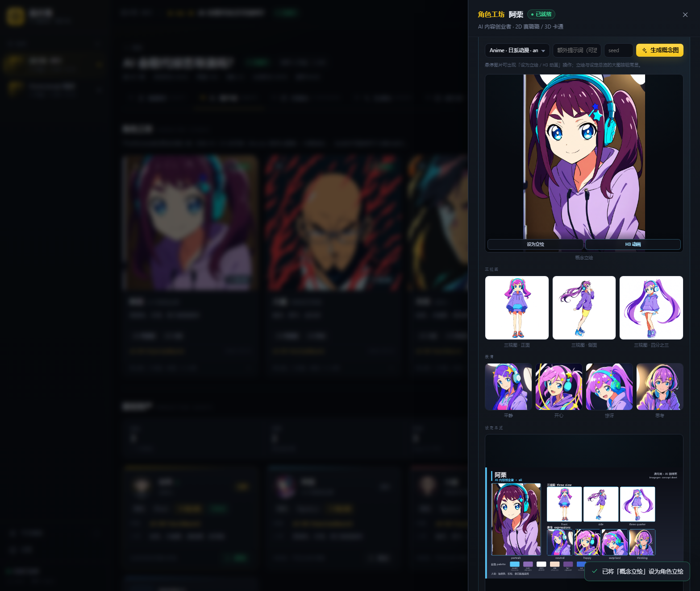 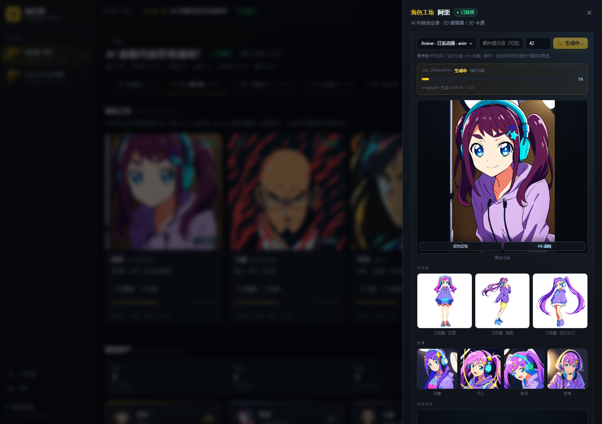 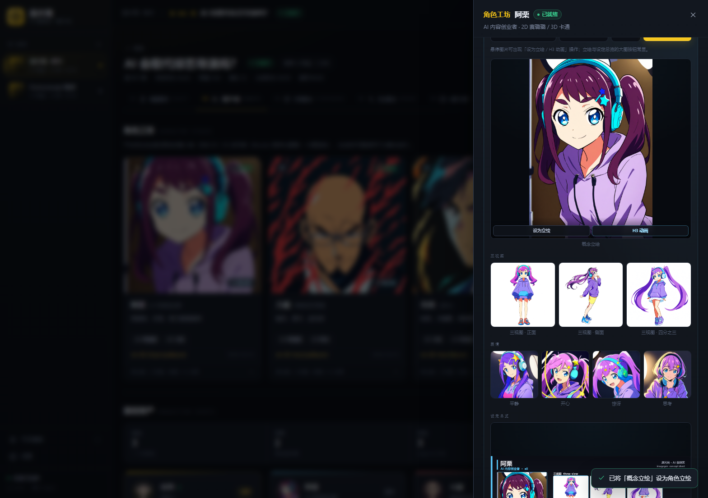

### 18.2 概念图 → H3 动画
- `POST /api/characters/{cid}/h3-animate` → Job(type=h3) → run_h3.py → outputs/h3/{cid}_h3.mp4（ComfyUI 串行，20 分钟超时）
- 真链路验收：`POST /characters/laozhou/h3-animate` → job **done 121.5s** → outputs/h3/laozhou_h3.mp4（768×768/24fps/h264+aac/5.167s/1,574,453 B，含音轨）；h3 中段帧回填 h3_portrait；Character 回填 h3_video_url/h3_portrait_url；/media 200。
- 前端角色抽屉可播放 H3 视频；截图：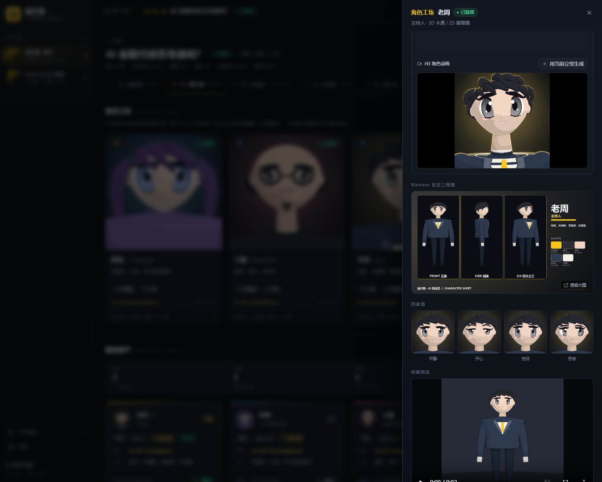

### 18.3 剪映草稿导出
- `POST /api/episodes/{eid}/export {"type":"capcut"}` → pipeline.capcut.py（pyJianYingDraft 0.3.1）
- 产物 outputs/exports/造片局_EP001：draft_content.json（canvas 1280×720/25fps/299s；52 视频段 + 1 旁白 + 42 字幕）、draft_meta_info.json、materials/、subtitles.srt、README.txt、audit ok
- 限制：本机剪映 10.3 加密草稿 JSON，不识别明文草稿；明文格式适用于 ≤5.9 或按 README 用 materials/+srt 重建
- 截图：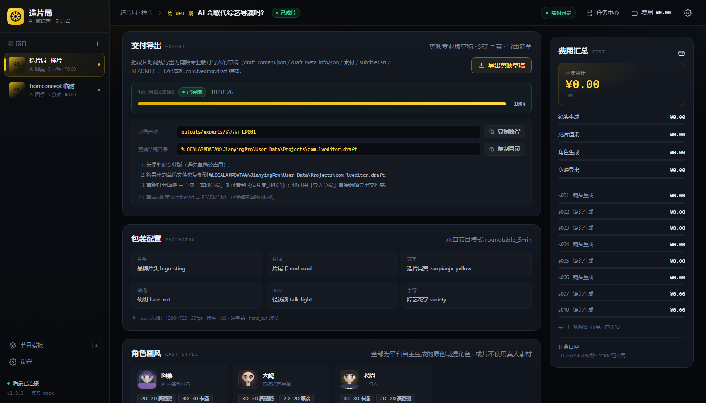

### 18.4 终态与测试
- backend pytest：**75 passed**；pipeline pytest：**34 passed**；前端 build 通过（dist 254KB JS/78KB CSS）
- 服务：http://127.0.0.1:8090（backend/run-detached.ps1 可独立常驻）；ComfyUI 8188 在线
- 已知：三视图/表情为独立生成（seed 家族相似，非像素级同一脸）；ComfyUI 单 worker 串行；剪映 10.x 加密限制；H3 单条约 2–5 分钟。
## 19. 角色 2.1：IP-Adapter 一致性 + 概念图驱动成片（2026-10-24 早）

### 19.1 IP-Adapter 一致性
- 安装 ComfyUI_IPAdapter_plus（cubiq）；模型：ip-adapter-plus_sdxl_vit-h（847,517,512 B，sha256 3f5062b8…e6581 ✓）+ CLIP-ViT-H-14（3,944,552,236 B，sha256 036e6e2b…b18d ✓）。
- imagegen 新增 --ref / --ip-adapter-strength（默认 0.65）/ --ip-adapter-end-at（0.85）；工作流 SDXL + IPAdapterUnifiedLoader + IPAdapterAdvanced（weight_type=linear）。
- 实测：3 角色 × 7 张（三视图 3 + 表情 4）= 21 张 consistent 图，1024×1024，单图 11–13s（模型驻留后），seed 42，无 OOM。
- 三视图采用低 weight（0.35/end 0.90）+ 背景负向词重跑，最终为**白底/单人全身**、发色服装与 portrait 一致；表情保留 weight 0.65 版本。
- 效果：脸型/发色/服装一致；IP-Adapter 仍可能带入立绘的光效风格（表情图上更明显），属已知取舍。
- 截图：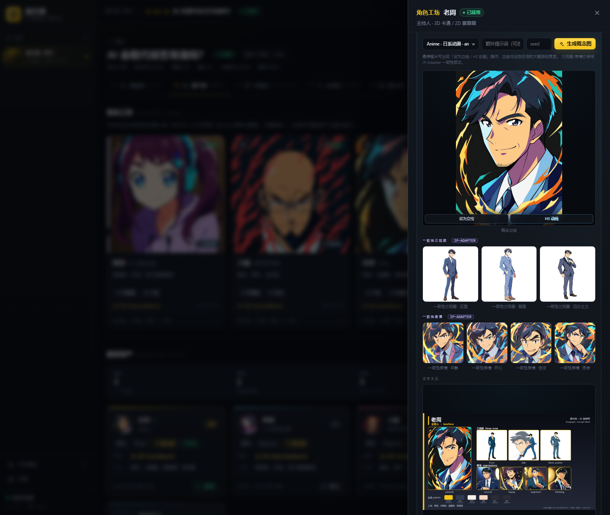

### 19.2 概念图驱动 H3（覆盖旧版本）
- laozhou/ali/dawei 三条 H3 全部用 outputs/concepts/{id}/portrait.png 驱动重生成：768×768 / 5.167s / 124 帧 / 含音轨；耗时 116–223s/条；中段帧回填 h3_portrait。
- 旧版保留 {id}_h3_prev.mp4；Character.h3_video_url 指向新文件。

### 19.3 成片升级（SDXL 概念角色）
- pipeline 素材优先级按 CONSISTENCY.md 落地：H3 视频 → h3 中段帧 → concepts/{id}/portrait.png（832×1216 竖构图裁胸像 + 右侧画窗 + Ken Burns）→ Blender cutout → 2D → 文字卡。
- outputs/demo/final.mp4：299.000s / 1280×720 / 25fps / 34,719,840 B（33.1MiB）/ blackdetect 0 条 / 52/52 角色画面 / H3 3/3 概念图驱动；冷渲 50.9s。
- 平台 outputs/episodes/ep_001/final.mp4：299.000s / 27,288,915 B / mtime 09:14:55（同一优先级重渲，/media 200）。
- 修复：角色镜头重复人名条（ASS 不再输出 Lower，51→49 事件）、字幕基线恢复 655。
- 截图：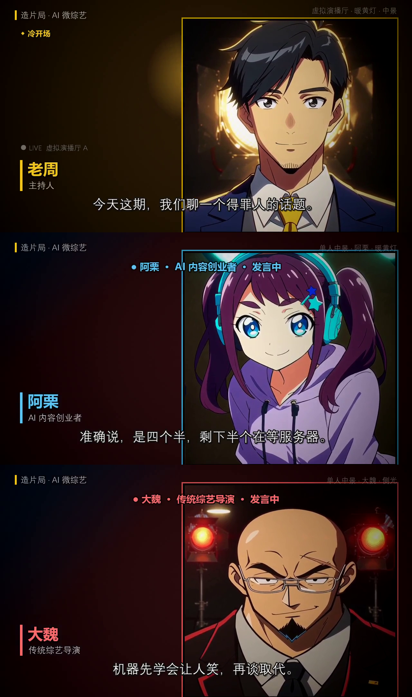 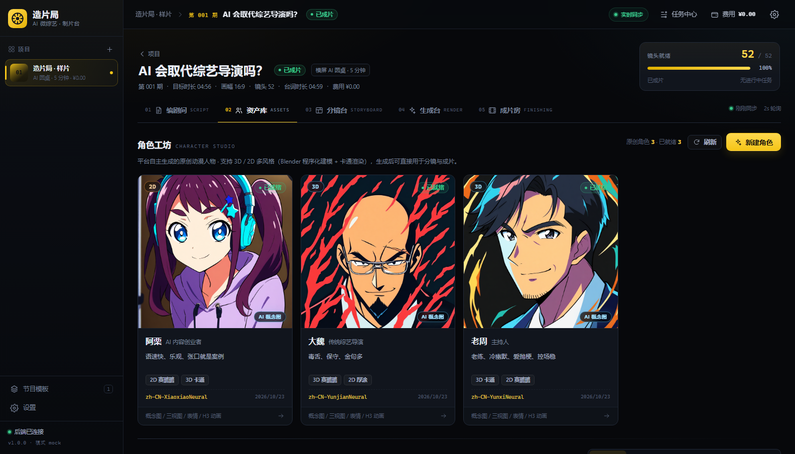 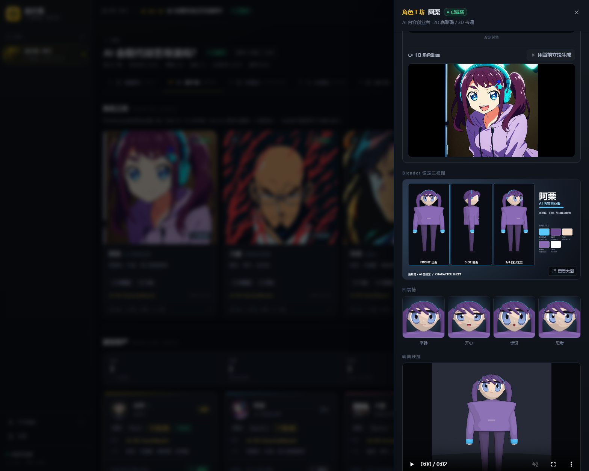

### 19.4 测试与状态
- pipeline：38 passed（新增概念素材优先级/竖构图裁切/概念表情/指纹/人名条去重）
- backend：**76 passed**（新增 consistent 懒扫描 + from-concept 简写路径）；pipeline 38 passed；frontend build 通过（dist 257KB JS/78KB CSS）
- 服务：8090 常驻（run-detached）；ComfyUI 8188 在线（IP-Adapter 节点已加载）
- 已知：三视图风格受 IP-Adapter 背景影响；H3 串行 2–5 分钟/条；剪映 10.x 加密草稿限制仍在。
## 20. H3 双 Provider：本地 ComfyUI（生产）+ MetaSo 云端（测试）

- 背景：本机 H3 单条 5s 镜头约 116–223s；为快速测试/迭代，接入用户提供的 MetaSo 云端 MiniMax H3 API（同模型同规格）。
- 实测（2026-10-24）：
  - t2v 5s/768P 16:9：16.2s 完成；
  - i2v 5s/768P（概念图驱动）：上传<1s + 创建 1–3s + 生成 ~21s + 下载 <1s，合计 23–25s/条；
  - 3 角色：laozhou 24.6s / ali 23.5s / dawei 24.3s；输出 768×1120（跟随立绘比例）/ 5.175s / h264+aac；
  - 价格 0.09 元/秒（5s≈0.45 元），2K 0.15 元/秒。
- 集成：integrations/metaso/h3.py（CLI）+ README；协议 /v1/files/upload → mm_file://、/v2/video_generation、/v2/query/video_generation/{id}；Key 存本地 backend/data/metaso.env（gitignore），仓库仅 .env.example。
- 策略：**默认 provider=local**（生产成片仍本机生成）；metaso 仅测试用，产物单独 outputs/h3/metaso/ 或 {id}_h3_metaso.mp4，不覆盖本地 H3；Settings 可切换 provider。
- 对比图：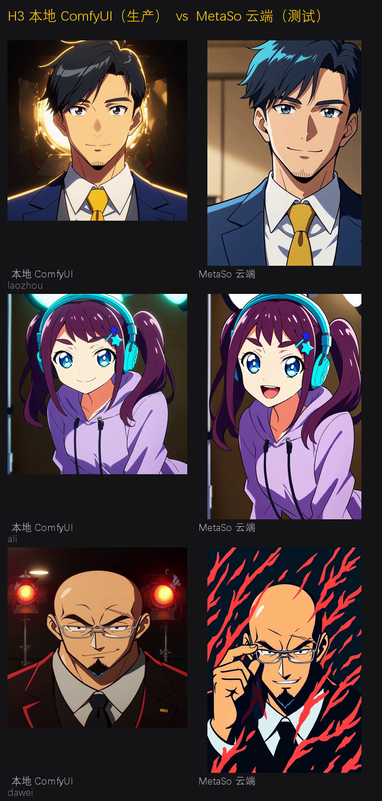

### 20.1 测试产物
- outputs/h3/metaso/{laozhou,ali,dawei}_metaso.mp4（各 5.175s/768×1120/含音轨）与 .meta.json（task_id/timeline/预估费用/ffprobe）
- outputs/h3/metaso/compare_local_vs_metaso.png（3 角色本地 vs 云端抽帧对比）
### 20.2 平台集成与端到端验收（2026-10-24）
- Settings 新增：h3_provider（local 默认 | metaso）、metaso_base_url、metaso_resolution（768P/2K）、metaso_duration（4-15）、metaso_key_configured（只读布尔，明文不回传）；PATCH 可写入/清除 key 到 backend/data/metaso.env。
- 真实端到端：
  - MetaSo：PATCH provider=metaso → POST /characters/laozhou/h3-animate → job_3f1c019e9d **done 24.1s** → outputs/h3/laozhou_h3_metaso.mp4（4,584,847B / 768×1120 / 5.175s / h264+aac），h3_metaso_url 回填，/media 200；本地 laozhou_h3.mp4 前后 sha1 一致（未被覆盖）。
  - local：job_bc80c07273 done **120.1s** → h3_video_url/h3_portrait_url 回填；与本机 ComfyUI 行为一致。
- 前端：设置弹窗「H3 生成方式」双选项（本地·生产 ↔ MetaSo 云端·测试）、Key 已配置状态、¥0.09/秒 · 5s≈¥0.45 提示；角色抽屉按钮与播放器显示 provider 徽标（云端测试·MetaSo）。实测 UI 切 provider → 云端 H3 job 24s done → 抽屉播放 ali_h3_metaso.mp4；随后恢复 provider=local。
- 安全：key 只在 backend/data/metaso.env / 环境变量；GET /settings 不含明文；仓库仅 .env.example。
- 测试：backend **83 passed**（新增 h3 provider 用例）、pipeline 38 passed。
- 默认策略：生产成片仍 local；metaso 仅测试/快速迭代，产物独立存放。
