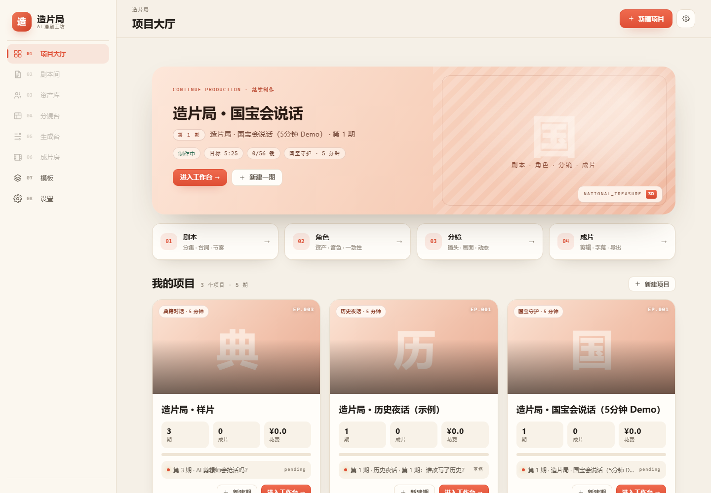
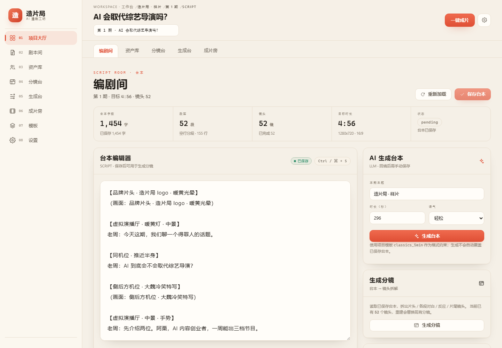
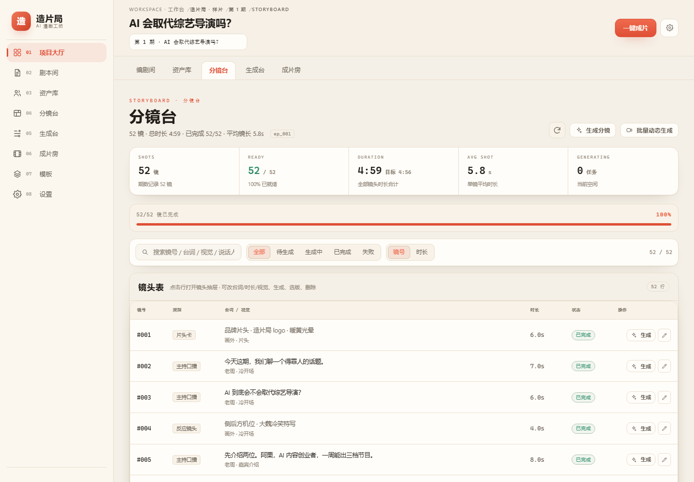
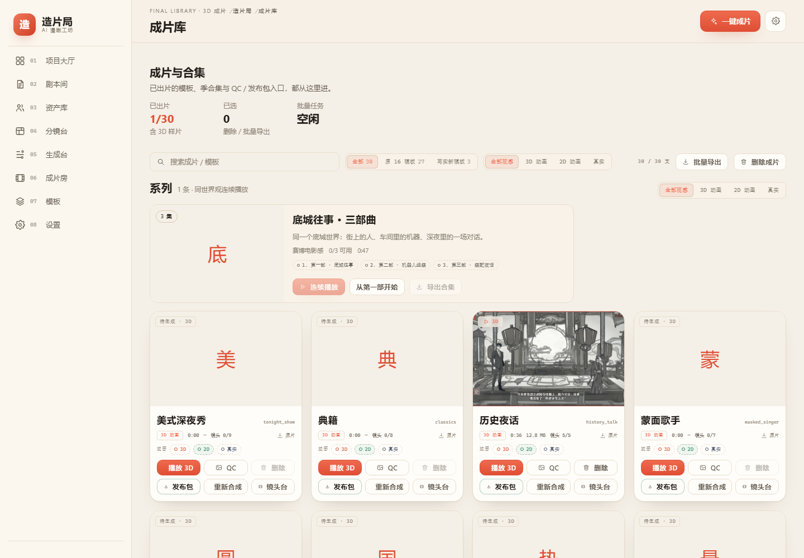
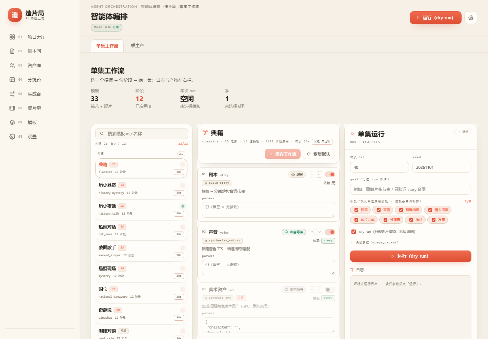

# UI 重设计 · 漫剧工坊风（2026-11）

> 参考方向：开源漫剧工作台 **AI 漫剧工坊（ai-comic-studio）** 的奶油纸底 + 珊瑚红强调 + 左侧工作流；项目卡布局参考 **Jellyfish** 的浅色创作台。
> 说明：你没有指定具体仓库名，我按“漫剧”最贴近的 AI 漫剧工坊做主视觉，融合 Jellyfish 的项目卡；如果你指的是 Toonflow / ArcReel，告诉我可以再切一版。
> 范围：只改视觉层与两处信息展示（项目卡进度、首页标题），不动交互、接口和数据。

## 1. 设计语言

| 维度 | 旧 | 新 |
|---|---|---|
| 底色 | 深色影棚（#07080b） | 暖纸（#f5f0e7）+ 极浅纸纹 |
| 主色 | 品牌金 #f5c518 | 珊瑚 #df4f35（hover #ef6a4e） |
| 卡片 | 12px 圆角、无阴影（R6 减法） | 16–20px 圆角、柔和暖阴影 |
| 导航 | 68px 图标轨，可收起 | 236px 常驻侧栏：品牌 + 编号导航 + 珊瑚激活态 |
| 首页 | Hero + 项目卡 | 珊瑚大 Hero + 4 步工作流 + 带封面/进度/统计的项目卡 |
| 标题 | 衬线/展示体 | 系统无衬线，700–800 字重，负字距 |
| 主题 | 跟随系统深/浅色 | 强制浅色，保证截图与观感一致 |

## 2. 页面

### 项目大厅


- 珊瑚渐变 Hero：项目名只保留主标题（去掉“（5分钟 Demo）”这类后缀，格式在 chips 里），右侧用模板首字做水印。
- 4 步工作流条：剧本 / 角色 / 分镜 / 成片，直达当前集的对应页。
- 项目卡：模板首字封面、期/成片/花费三格统计、进度条、最近一集状态、珊瑚主按钮。

### 剧本间


- 顶栏恢复“面包屑 + 期数下拉 + 页签”的层次；KPI 卡、编辑器、右侧 AI 面板统一暖白卡面。
- 编辑器保留衬线正文（原设计），更接近剧本阅读。

### 分镜台


- KPI 条去掉旧版 `is-jade` 的绿色底（`:is(.is-jade)` 通用规则误伤），改为白底 + 绿色数字。
- 工具条、表格、状态标签、行操作统一圆角与边框；表格仍保留（看板视图是下一步，不在本次范围）。

### 成片库


- 空封面用大号珊瑚首字 + 暖色渐变；已出片卡保留海报。
- 系列卡、筛选、播放/QC/发布按钮统一主色。

### 智能体编排


- 三栏（模板 / 阶段 / 运行）统一卡面与输入框；阶段卡仍保留原有粉/绿 agent 标签（信息色）。
- 侧栏品牌、顶栏、按钮与全站一致。

## 3. 实现

- 新增 [redesign.css](../frontend/src/styles/redesign.css)，在 `design.css` 之后、`main.tsx` 最后引入；用 token 覆盖 + 关键组件选择器覆盖旧“去装饰”规则。
- `AppShell`：品牌区增加「造片局 / AI 漫剧工坊」文字，桌面端侧栏常驻 236px。
- `PlatformHome`：修掉旧模板卡 meta 的圆点排版，改为三格统计；新增进度条、模板首字封面、Hero 水印、4 步工作流条；Hero 标题去掉括号后缀。
- 工作室/库/Agent 页以 token 与容器样式为主，不改组件结构。

## 4. 验证

```powershell
npm run build --prefix frontend   # tsc --noEmit + vite build，0 error
```

- 截图取自 `http://127.0.0.1:8090`，Chrome headless 1440×1000。
- 页面：`#/projects`、`#/episodes/ep_001/script`、`#/episodes/ep_001/storyboard`、`#/library/final`、`#/agent`。

## 5. 已知取舍

1. **强制浅色**：暂不跟随系统深色，保证“漫剧工坊”观感一致；后续可用 `data-theme` 做双主题。
2. **分镜仍是表格**：参考项目的看板（待生成帧/提示词/视频/已完成）需要新的状态映射与拖拽，属于交互改造，未在本轮做。
3. **Agent 页保留信息色**：阶段卡的粉/绿标签是 agent 状态语义，未全部压成珊瑚。
4. **移动端**：沿用原抽屉导航；截图仅覆盖桌面 1440。
5. **封面资产**：多数模板还没有 poster，项目卡使用模板首字水印；补海报后会自动替换为图片。
